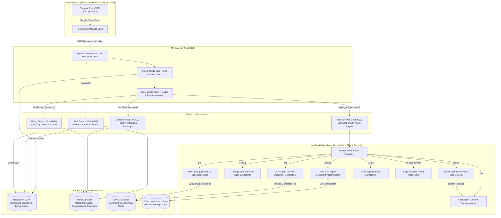

# ⚡ Nexora AI - Next-Generation Multi-Agent AI Workspace & Artifact Engine

> **Nexora AI** is an enterprise-grade, distributed AI workspace platform engineered with microservices architecture, LangGraph multi-agent orchestration, interactive real-time code artifacts, vector-powered document intelligence (RAG), presentations, and integrated billing.

---

## 🌟 Overview & Key Highlights

Nexora AI is designed to replicate and expand upon state-of-the-art AI workspace platforms (such as Claude Artifacts and Cursor):
- **Dynamic Multi-Agent System**: Powered by LangGraph and LangChain, user intents are dynamically classified by a central Router Agent and dispatched to specialized sub-agents (Coding, Web Search, PDF Document Generator, PPT Generator, Vision/Image Analysis, and Vector-based PDF RAG).
- **Interactive Live Artifacts**: Generates multi-file codebases (HTML, CSS, JavaScript) that execute in real-time inside an isolated, sandboxed in-browser iframe alongside a full Monaco Code Editor.
- **Enterprise Microservice Architecture**: Decoupled Node.js/Express services communicating across an API Gateway, Redis distributed session cache, and MongoDB persistence.
- **Robust Authentication**: Firebase Authentication on the client synchronized with server-side HTTP-only session cookies and distributed Redis token stores.
- **Credit & Billing Engine**: Razorpay-backed subscription payments with credit tiering and automated credit deduction per agent interaction.

---

## 🏗️ System Architecture & Workflow

### 1. High-Level Architecture Flowchart



---

## 🔁 Detailed Execution Lifecycle

### Request Journey: From User Prompt to Artifact Render

1. **User Authentication & Session Initialization**:
   - The user signs in via Google OAuth on the frontend.
   - The Firebase ID Token is exchanged with the Gateway -> Auth Service (`/api/auth/login`).
   - The Auth Service verifies the token via Firebase Admin SDK, stores or fetches the user in MongoDB, initializes a unique session UUID with a 7-day TTL in Redis, and issues an HTTP-only `session` cookie (`SameSite: Lax`).
   - Frontend Redux state synchronizes via both `getCurrentUser()` (`/api/me`) and `onAuthStateChanged()`.

2. **Prompt Dispatch & Agent Routing**:
   - The user enters a prompt (e.g., *"Build an interactive timer app"* or *"Search latest AI news and summarize"*).
   - Gateway validates the session against Redis and injects the verified `x-user-id` header into the request stream.
   - The Agent Service validates credit balance for the user, deducts the required credits, and forwards the conversation state into the **LangGraph workflow**.
   - The **Router Node** inspects message history and system context to choose the optimal specialized agent.

3. **Specialized Agent Execution**:
   - **Coding Agent**: Structures code into standardized multi-file JSON bundles (`index.html`, `style.css`, `script.js`).
   - **Search Agent**: Queries Tavily for real-time web results and pipes synthesized data into the conversational chat agent.
   - **PDF / PPT Generator**: Generates formatted PDFs or PowerPoint decks programmatically and uploads the artifacts to Amazon S3.
   - **PDF RAG Agent**: Computes text embeddings, queries the vector database for document chunks, and synthesizes grounded answers.

4. **Response Delivery & Artifact Rendering**:
   - Agent output and artifact metadata are stored in MongoDB via the Chat Service.
   - Frontend receives the response:
     - Textual commentary renders in markdown with syntax highlighting.
     - Code artifacts trigger the **Artifact Drawer**: users can inspect the files inside the embedded **Monaco Editor** or toggle to the **Live Preview** tab to run the app immediately in a secure sandboxed iframe.

---

## ✨ Features Implemented

| Category | Features |
| :--- | :--- |
| **Agentic AI** | • LangGraph state machines with conditional branching<br>• Dynamic Query Router<br>• Real-time web search (Tavily)<br>• PDF Generation (PDFKit) & Presentation Generation (PptxGenJS)<br>• Document RAG (Embeddings + Vector Search)<br>• Vision and Multimodal Image Analysis |
| **Artifact Studio** | • Multi-file tabbed code explorer (`index.html`, `style.css`, `script.js`)<br>• Embedded Monaco Editor with dark mode and full syntax highlighting<br>• Real-time sandboxed live preview in isolated iframe<br>• One-click clipboard copy and responsive drawer toggling |
| **Microservices** | • API Gateway with cookie parsing, CORS handling, and proxy headers<br>• Dedicated Auth, Chat, Agent, and Billing microservices<br>• Redis distributed session store & credit synchronization<br>• Dockerized configuration with Docker Compose |
| **Security & Auth** | • Firebase Google OAuth client-side integration<br>• Server-side token verification with Firebase Admin SDK<br>• HTTP-only, secure, `SameSite=Lax` session cookies<br>• Two-way client/server auth sync with automatic session recovery |
| **Billing & Credits** | • Razorpay checkout integration with verification webhooks<br>• Multi-tiered plans (Free, Pro, Enterprise)<br>• Usage-based credit deduction per agent interaction |
| **Cloud & DevOps** | • AWS ECS & ECR container deployment pipeline (GitHub Actions)<br>• Frontend automated build & S3/CloudFront deployment<br>• Complete Dockerfiles for all microservices |

---

## 🛠️ Tech Stack

- **Frontend**: React 19, Redux Toolkit, Tailwind CSS v4, Motion (Framer Motion), Monaco Editor, Lucide React, Axios, Firebase Client SDK.
- **API Gateway**: Express.js, `express-http-proxy`, `cookie-parser`, `cors`, `morgan`.
- **Microservices**: Node.js, Express.js.
- **AI & Orchestration**: LangChain, `@langchain/langgraph`, `@langchain/openai`, `@langchain/google-genai`, Tavily Search API.
- **Databases & Cache**: MongoDB Atlas (Mongoose), Redis (ioredis), Pinecone / Vector store.
- **Cloud & Media**: Amazon S3 (`@aws-sdk/client-s3`), Docker, Docker Compose, AWS ECS, AWS CloudFront.
- **Payments**: Razorpay Node SDK.

---

## 🚀 Installation & Setup Guide

### Prerequisites
Make sure the following are installed on your machine:
- **Node.js** (v18.x, v20.x, or v22.x) & **npm**
- **Docker Desktop** (for running Redis locally)
- **Git**
- A **MongoDB Atlas** account (or local MongoDB)
- A **Firebase** project (for Google Authentication)

---

### Step 1: Clone the Repository

```bash
git clone https://github.com/<your-username>/nexora-ai.git
cd nexora-ai
```

---

### Step 2: Configure Environment Variables

Create `.env` files in each service directory by copying their respective `.env.example` templates:

#### 1. Frontend (`frontend/.env`)
```env
VITE_FIREBASE_API_KEY=your_firebase_web_api_key
VITE_RAZORPAY_KEY_ID=your_razorpay_key_id
VITE_SERVER_URL=http://localhost:8000
```

#### 2. API Gateway (`backend/gateway/.env`)
```env
PORT=8000
AUTH_SERVICE=http://localhost:8001
CHAT_SERVICE=http://localhost:8002
AGENT_SERVICE=http://localhost:8003
BILLING_SERVICE=http://localhost:8004
FRONTEND_URL=http://localhost:5173
REDIS_URL=redis://localhost:6379
```

#### 3. Auth Service (`backend/services/auth/.env`)
```env
PORT=8001
MONGODB_URI=your_mongodb_connection_string
REDIS_URL=redis://localhost:6379
```
> **Firebase Service Account:** Place your Firebase Admin service account key JSON at `backend/services/auth/serviceAccountKey.json`.

#### 4. Chat Service (`backend/services/chat/.env`)
```env
PORT=8002
MONGODB_URI=your_mongodb_connection_string
```

#### 5. Billing Service (`backend/services/billing/.env`)
```env
PORT=8004
MONGODB_URI=your_mongodb_connection_string
RAZORPAY_KEY_ID=your_razorpay_key_id
RAZORPAY_KEY_SECRET=your_razorpay_key_secret
AUTH_SERVICE=http://localhost:8001
```

#### 6. Agent Service (`backend/services/agent/.env`)
```env
PORT=8003
MONGODB_URI=your_mongodb_connection_string
OPENAI_API_KEY=your_openai_api_key
GEMINI_API_KEY=your_gemini_api_key
TAVILY_API_KEY=your_tavily_api_key
AWS_ACCESS_KEY=your_aws_access_key
AWS_SECRET_ACCESS_KEY=your_aws_secret_key
AWS_REGION=your_aws_region
S3_BUCKET_NAME=your_s3_bucket_name
AUTH_SERVICE=http://localhost:8001
```

---

### Step 3: Install Dependencies

Run the following install commands across each directory:

```bash
# 1. Root & Backend shared
cd backend
npm install

# 2. Gateway
cd gateway
npm install

# 3. Auth Service
cd ../services/auth
npm install

# 4. Chat Service
cd ../chat
npm install

# 5. Agent Service
cd ../agent
npm install

# 6. Billing Service
cd ../billing
npm install

# 7. Frontend
cd ../../../frontend
npm install
```

---

### Step 4: Running the Platform

#### Option A: One-Click Startup (Windows)
Run the bundled launcher script from the root directory:
```cmd
run_all.bat
```
*This command starts Docker Redis, API Gateway, all 4 microservices, and the Vite frontend dev server in dedicated windows.*

#### Option B: Manual Step-by-Step Startup

**1. Start Redis (via Docker Compose):**
```bash
cd backend
docker compose up -d
```

**2. Start API Gateway (Port 8000):**
```bash
cd backend/gateway
npm run dev
```

**3. Start Auth Service (Port 8001):**
```bash
cd backend/services/auth
npm run dev
```

**4. Start Chat Service (Port 8002):**
```bash
cd backend/services/chat
npm run dev
```

**5. Start Agent Service (Port 8003):**
```bash
cd backend/services/agent
npm run dev
```

**6. Start Billing Service (Port 8004):**
```bash
cd backend/services/billing
npm run dev
```

**7. Start Frontend (Port 5173):**
```bash
cd frontend
npm run dev
```

---

### Step 5: Open the Application
Navigate to **`http://localhost:5173`** in your browser.
Click **Continue with Google** to log in and start generating conversational and artifact workflows!

---

## 🔒 Security Best Practices
- **No Secrets in Version Control**: All `.env` files and Firebase `serviceAccountKey.json` credentials are fundamentally excluded via `.gitignore`.
- **HTTP-Only Cookies**: User session identifiers are stored in HTTP-Only cookies with `SameSite=Lax` to prevent XSS credential theft.
- **Sandboxed Execution**: Generated artifact HTML/JS code executes inside an isolated iframe sandbox to prevent script leakage to the host window.

---

## 📄 License
This project is licensed under the [ISC License](LICENSE).
